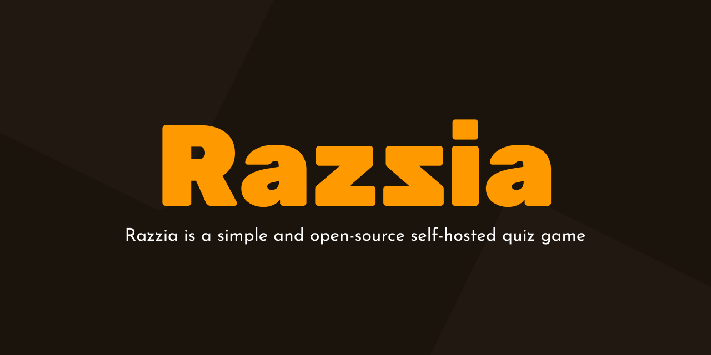
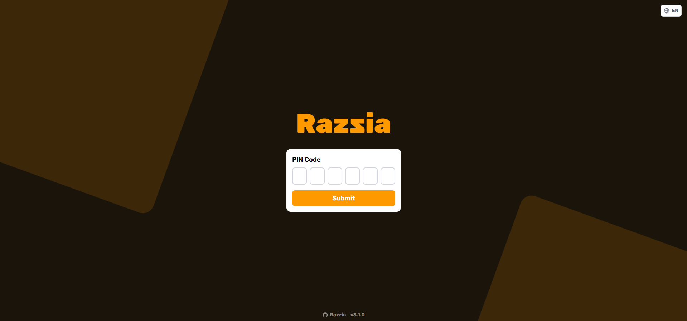
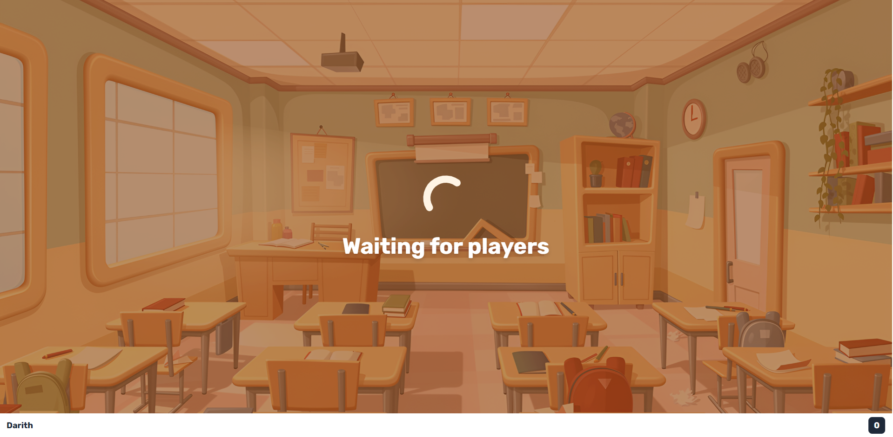
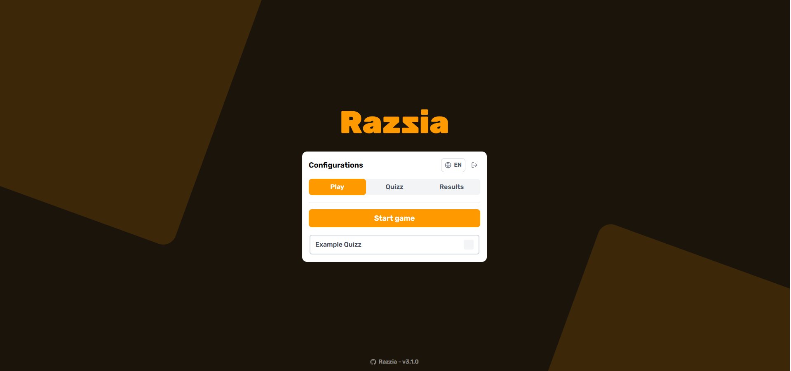
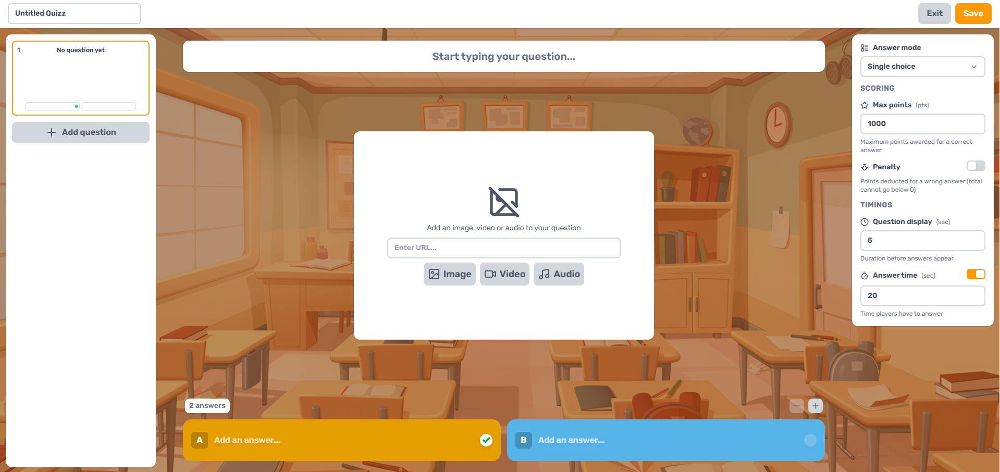
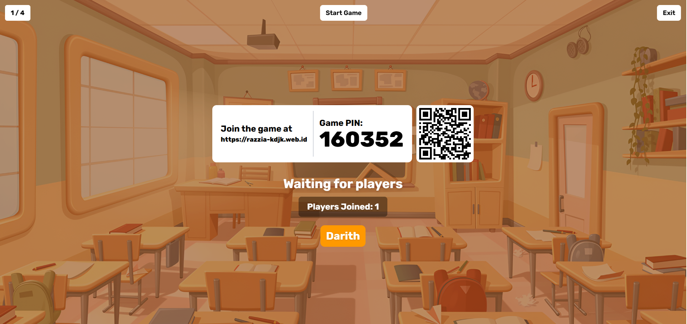

<div align="center">



## Razzia, Aplikasi Kuis Berbasis Web

**Dari aplikasi lokal menuju layanan kuis yang dapat diakses melalui server VPS.**

**Praktikum KDJK 2026/2027 · P1 — Kelompok 8**

**Akses aplikasi Razzia pada: [razzia-kdjk.web.id](https://razzia-kdjk.web.id)**

`Ubuntu 24.04 LTS` · `Docker` · `Docker Compose` · `Razzia` · `Caddy` · `HTTPS`

---

</div>

# 👥 Anggota Kelompok

| NIM | Nama |
|---|---|
| M0403241022 | Faisal Mumtaz Hidayat |
| M0403241008 | Kafka Muhammad Arya |
| M0403241104 | Daffa M. Robbani |
| M0403241092 | Sinar Marthin Simanjuntak |
| M0403241036 | Raihan Fikri |


# Daftar Isi

- [Sekilas Tentang](#sekilas-tentang)
- [Instalasi](#instalasi)
- [Empat Script Utama](#empat-script-utama)
- [Konfigurasi](#konfigurasi)
- [Maintenance](#maintenance)
- [Cara Pemakaian](#cara-pemakaian)
- [Pembahasan](#pembahasan)
- [Referensi](#referensi)


---

# 📖 Sekilas Tentang

### Apa itu Razzia?

[Razzia](https://github.com/ralex91/razzia) adalah aplikasi kuis berbasis web yang dapat di-*host* sendiri (*self-hosted*). Aplikasi ini memungkinkan pengelola membuat dan menjalankan sesi kuis, sementara peserta dapat bergabung dan menjawab pertanyaan melalui browser.

Dengan pendekatan *self-hosted*, Razzia dapat dijalankan pada server milik sendiri sehingga pengelola memiliki kendali atas konfigurasi aplikasi dan pengelolaan infrastrukturnya.

### Arsitektur deployment

Razzia dijalankan dalam container Docker pada VPS Ubuntu dan dikelola menggunakan Docker Compose. Agar dapat diakses melalui domain dengan koneksi HTTPS, aplikasi ditempatkan di belakang reverse proxy, seperti Caddy.

Alur komunikasi aplikasi adalah sebagai berikut:

```text
Pengguna / Peserta
       │
       ▼
Browser ── HTTPS ──► Domain publik
                         │
                         ▼
                 Reverse proxy (Caddy)
                         │ HTTP lokal
                         ▼
                 127.0.0.1:3000
                         │
                         ▼
                 Docker Compose
                         │
                         ▼
                   Razzia container
                         │
                         ▼
                 /opt/razzia/config
```

Pemetaan port 127.0.0.1:3000:3000 membatasi publikasi port aplikasi ke loopback VPS. Dengan demikian, akses publik diarahkan melalui reverse proxy, bukan langsung melalui port aplikasi.

Catatan: Docker Compose mengelola container Razzia, sedangkan konfigurasi Caddy, DNS domain, dan sertifikat TLS merupakan bagian terpisah yang perlu disiapkan agar aplikasi dapat diakses melalui HTTPS.

### Konfigurasi Deployment

| Komponen | Detail |
|---|---|
| Sistem operasi VPS | Ubuntu 24.04 LTS |
| Aplikasi | Razzia |
| Image container | `ralex91/razzia:latest` |
| Runtime | Docker Engine + Docker Compose plugin |
| Direktori aplikasi | `/opt/razzia` |
| Direktori backup | `/opt/razzia-backups` |
| Port aplikasi | `3000` pada loopback `127.0.0.1` |
| Domain | `razzia-kdjk.web.id` |

---

# 📄 Empat Script Utama

Proyek ini menyediakan empat script shell untuk membantu pengelolaan aplikasi Razzia di VPS. Setiap script memiliki fungsi tersendiri, mulai dari instalasi awal hingga pencadangan, pemulihan, dan pembaruan aplikasi.

| Script | Fungsi |
|---|---|
| `setup.sh` | Menyiapkan konfigurasi dan menjalankan instalasi awal Razzia pada VPS. |
| `backup.sh` | Membuat arsip backup yang berisi konfigurasi deployment dan konfigurasi aplikasi. |
| `restore.sh` | Memulihkan konfigurasi deployment dan aplikasi dari arsip backup. |
| `update.sh` | Memperbarui image Razzia dengan mekanisme rollback jika terjadi kegagalan. |

Keempat script tersebut dirancang untuk menyederhanakan pengelolaan aplikasi dan mengurangi kebutuhan menjalankan langkah-langkah secara manual. Penjelasan mengenai prasyarat, cara penggunaan, serta proses instalasi dan pemeliharaan tersedia pada bagian berikutnya.

---

# 🛠 Instalasi

### 1. Prasyarat

Siapkan hal-hal berikut sebelum menjalankan script:

- VPS Ubuntu 24.04 dengan akses `sudo` atau root.
- Akses SSH ke VPS.
- Docker Engine dan plugin Docker Compose sudah terpasang dan berjalan.
- Koneksi internet untuk mengunduh image aplikasi.
- Domain yang DNS-nya diarahkan ke alamat IP publik VPS apabila aplikasi akan diakses melalui domain.
- Port `80/tcp` dan `443/tcp` dapat diakses dari internet untuk konfigurasi HTTPS.
- Empat script utama: `setup.sh`, `backup.sh`, `restore.sh`, dan `update.sh`.

> **Penting:** `setup.sh` memeriksa keberadaan Docker dan Docker Compose. Script ini tidak memasang Docker Engine. Pasang Docker terlebih dahulu menggunakan dokumentasi resmi Docker untuk Ubuntu.

### 2. Hubungkan ke VPS

Dari terminal komputer, jalankan perintah SSH berikut. Ganti `USER` dengan akun server yang diberikan penyedia VPS.

```bash
ssh USER@IP_PUBLIK_VPS
```

Setelah masuk, periksa versi sistem operasi:

```bash
lsb_release -a
```

Periksa Docker dan Compose:

```bash
docker --version
docker compose version
sudo docker info
```

Jika perintah Docker memerlukan hak administrator, gunakan `sudo` saat menjalankan script.

### 3. Siapkan berkas script

Simpan empat script pada direktori kerja, lalu pastikan nama berkasnya sesuai:

```text
deployment/
├── setup.sh
├── backup.sh
├── restore.sh
└── update.sh
```

Jika script dikirim dari komputer lokal, unggah ke VPS menggunakan `scp` atau metode transfer berkas lain yang tersedia. Contoh:

```bash
scp setup.sh backup.sh restore.sh update.sh USER@IP_PUBLIK_VPS:~/
```

Di VPS, periksa berkas yang diterima:

```bash
ls -l ~/setup.sh ~/backup.sh ~/restore.sh ~/update.sh
```

### 4. Jalankan instalasi Razzia

Jalankan script setup:

```bash
sudo bash ~/setup.sh
```

Script akan melakukan hal-hal berikut:

1. Memastikan script dijalankan sebagai root dan Docker Compose tersedia.
2. Memasang `curl` dan `python3` jika belum tersedia.
3. Membuat direktori `/opt/razzia` dan `/opt/razzia/config`.
4. Membuat `compose.yml` jika belum ada.
5. Meminta password manager dan konfirmasinya jika `config/game.json` belum tersedia.
6. Memvalidasi konfigurasi dan memastikan port aplikasi diterbitkan hanya ke loopback.
7. Mengunduh image Razzia, menjalankan container, dan memeriksa respons HTTP lokal.

**Jangan gunakan password default atau password yang mudah ditebak.** Ketik password ketika diminta; input password tidak ditampilkan di terminal.

### 5. Verifikasi instalasi

Periksa status container:

```bash
cd /opt/razzia
sudo docker compose -f compose.yml ps
```

Lihat log aplikasi jika diperlukan:

```bash
sudo docker compose -f /opt/razzia/compose.yml logs --tail=100
```

Uji endpoint lokal:

```bash
curl -I http://127.0.0.1:3000/
```

Jika endpoint merespons, aplikasi telah melewati pemeriksaan HTTP lokal. Ini belum memastikan domain publik atau HTTPS berfungsi.

---

# ⚙️ Konfigurasi

### 1. Struktur direktori

Setelah instalasi, struktur utama yang digunakan adalah:

```text
/opt/razzia/
├── compose.yml
└── config/
    └── game.json

/opt/razzia-backups/
├── razzia-backup-<waktu>-<pid>.tar.gz
├── pre-update-<waktu>-<pid>.tar.gz
└── pre-update-<waktu>-<pid>.rollback.json
```

Direktori backup dibuat oleh script pemeliharaan sesuai kebutuhan. Nama berkas aktual memuat penanda waktu dan/atau PID.

### 2. Docker Compose

Konfigurasi dasar yang dibuat oleh `setup.sh` kurang lebih berbentuk:

```yaml
services:
  razzia:
    image: ralex91/razzia:latest
    restart: unless-stopped
    ports:
      - "127.0.0.1:3000:3000"
    volumes:
      - ./config:/app/config
```

Keterangan:

- `image`: image Razzia yang diunduh dari registry.
- `restart: unless-stopped`: container akan dimulai kembali secara otomatis kecuali dihentikan secara eksplisit.
- `127.0.0.1:3000:3000`: port aplikasi hanya dipublikasikan pada loopback VPS, bukan langsung pada semua antarmuka jaringan.
- `./config:/app/config`: konfigurasi aplikasi pada host dipasang ke direktori konfigurasi di container.

Pemetaan loopback membatasi akses langsung ke port aplikasi dari luar VPS. Untuk akses publik, gunakan reverse proxy yang dikonfigurasi secara terpisah.

### 3. Password manager

Berkas `/opt/razzia/config/game.json` menyimpan konfigurasi aplikasi. Script setup membuat konfigurasi awal seperti berikut:

```json
{
  "managerPassword": "GANTI_DENGAN_PASSWORD_KUAT"
}
```

Contoh di atas hanya contoh format. Gunakan password buatan sendiri.

Lindungi berkas konfigurasi karena memuat rahasia:

```bash
sudo ls -l /opt/razzia/config/game.json
sudo stat -c '%a %n' /opt/razzia/config/game.json
```

Script setup mengatur izin `game.json` menjadi `600` dan direktori `config` menjadi `700`. Jangan menampilkan atau menyalin password ke laporan, screenshot, repositori publik, maupun pesan yang dapat diakses orang lain.

### 4. Domain dan HTTPS (Opsional)

Secara default, aplikasi Razzia berjalan pada `127.0.0.1:3000` di VPS. Jika ingin mengakses aplikasi melalui domain dengan HTTPS, pengguna perlu menyiapkan domain milik sendiri dan mengonfigurasi DNS, reverse proxy, serta sertifikat TLS.

Agar aplikasi dapat diakses melalui HTTPS, pastikan:

1. Domain milik sendiri telah diarahkan ke IP publik VPS melalui DNS.
2. Reverse proxy (misalnya Caddy) telah terpasang dan berjalan.
3. Reverse proxy meneruskan permintaan domain ke `127.0.0.1:3000`.
4. Firewall VPS dan aturan penyedia VPS mengizinkan koneksi HTTP/HTTPS yang diperlukan.
5. Sertifikat TLS berhasil diterbitkan dan mekanisme perpanjangannya telah dikonfigurasi.

Contoh konfigurasi Caddy:

```caddyfile
quiz.example.com {
    reverse_proxy 127.0.0.1:3000
}
```

Ganti `quiz.example.com` dengan domain milik sendiri. Contoh tersebut merupakan konfigurasi reverse proxy yang perlu diterapkan secara manual dan **tidak dibuat otomatis oleh empat script utama** (`setup.sh`, `backup.sh`, `restore.sh`, dan `update.sh`).

Setelah konfigurasi selesai, verifikasi akses HTTPS menggunakan perintah berikut:

```bash
curl -I https://quiz.example.com
```

---

# 🔧 Maintenance

Pemeliharaan membantu menjaga konfigurasi tetap dapat dipulihkan dan mengurangi risiko saat melakukan perubahan.

### 1. Backup berkala

Jalankan backup sebelum perubahan konfigurasi dan sebelum update:

```bash
sudo bash ~/backup.sh
```

Script membuat arsip di direktori:

```text
/opt/razzia-backups/
```

Isi backup meliputi:

- `compose.yml`
- Direktori `config/`, termasuk `config/game.json`

Script memvalidasi arsip, membatasi izin akses, dan melaporkan lokasi berkas yang dibuat.

**Batasan backup:** arsip ini tidak mencakup image Docker, konfigurasi Caddy, sertifikat TLS, maupun data di luar `config/`. Salin backup ke tempat penyimpanan lain di luar VPS. Jangan mengunggah arsip yang mengandung password ke repositori publik.

### 2. Restore dari backup

Restore mengganti `compose.yml` dan seluruh direktori `config/` dengan versi di dalam arsip. Proses ini dapat menyebabkan aplikasi berhenti sementara.

Jalankan:

```bash
sudo bash ~/restore.sh /opt/razzia-backups/NAMA_BACKUP.tar.gz
```

Ganti `NAMA_BACKUP.tar.gz` dengan nama arsip yang benar. Ketika diminta konfirmasi, ketik `YES` hanya setelah memeriksa bahwa berkas backup yang dipilih memang benar.

Sebelum menerapkan restore, script:

1. Memvalidasi isi arsip dan jalur berkas.
2. Mengekstrak berkas ke direktori staging.
3. Memeriksa konfigurasi JSON dan Docker Compose.
4. Meminta konfirmasi.
5. Membuat *safety backup* dari konfigurasi aktif sebelum menggantinya.

Setelah restore, script menguji respons HTTP lokal dan mencoba mengembalikan konfigurasi sebelumnya jika proses gagal. Mekanisme rollback tersebut tidak memulihkan image Docker atau konfigurasi Caddy/TLS.

### 3. Update aplikasi

Jalankan:

```bash
sudo bash ~/update.sh
```

Script update:

1. Memvalidasi deployment aktif.
2. Membuat backup konfigurasi.
3. Menyimpan image container yang sedang digunakan dengan tag lokal untuk kebutuhan rollback.
4. Meminta konfirmasi sebelum update.
5. Mengunduh image yang dikonfigurasi dan menerapkan update.
6. Memeriksa endpoint HTTP lokal.
7. Mencoba menjalankan kembali image lama jika update gagal atau pemeriksaan HTTP tidak berhasil.

Script ini sengaja dibatasi untuk deployment Docker Compose dengan **tepat satu service dan satu container**. Jangan menganggapnya sebagai mekanisme update universal untuk semua stack Compose.

Jika rollback image diperlukan, script menampilkan lokasi berkas `*.rollback.json` dan nama image rollback. Simpan informasi tersebut dan ikuti instruksi output script. Tag image rollback dipertahankan; lakukan pembersihan hanya setelah yakin image tersebut tidak lagi diperlukan.

### 4. Pemeriksaan rutin

| Frekuensi | Pemeriksaan |
|---|---|
| Sebelum perubahan | Buat backup dan periksa ruang disk |
| Setelah update | Periksa `docker compose ps`, log, dan HTTP lokal |
| Secara berkala | Pastikan backup tersedia dan salin ke luar VPS |
| Setelah perubahan domain/TLS | Uji URL HTTPS dari luar VPS |
| Saat ada masalah | Periksa log container dan reverse proxy |

Perintah diagnostik yang berguna:

```bash
sudo docker compose -f /opt/razzia/compose.yml ps
sudo docker compose -f /opt/razzia/compose.yml logs --tail=100
df -h
```


---

# 💡 Cara Pemakaian

### Membuka Aplikasi

Setelah deployment dan konfigurasi domain/HTTPS selesai, buka domain yang telah dikonfigurasi. Pada deployment kelompok ini, alamat yang digunakan adalah:

**[https://razzia-kdjk.web.id](https://razzia-kdjk.web.id)**

Jika domain belum dikonfigurasi atau HTTPS belum aktif, jalankan pemeriksaan berikut langsung pada VPS:

```bash
curl -I http://127.0.0.1:3000/
```

Alamat loopback tersebut hanya dapat digunakan dari VPS itu sendiri. Untuk mengakses aplikasi dari perangkat lain, selesaikan konfigurasi DNS dan reverse proxy terlebih dahulu.

### Sisi Peserta (User)

1. Buka aplikasi Razzia melalui browser.

2. Masukkan kode sesi yang diberikan oleh manager.
3. Tunggu hingga peserta lain siap dan permainan dimulai.

4. Jawab pertanyaan yang ditampilkan sebelum waktu habis.
5.[Menjawab Pertanyaan Kuis](images/3.png)

### Sisi Admin (Manager)

1. Buka aplikasi Razzia dan masuk ke halaman manager menggunakan password manager.

2. Buka tab `Quizz` pada halaman `Configurations`.
3. Buat kuis baru hingga editor kuis terbuka.

4. Masukkan judul kuis, tambahkan pertanyaan dan pilihan jawaban, lalu tandai jawaban yang benar.
5. Atur poin dan waktu sesuai kebutuhan, kemudian klik `Save`.
6. Buka tab `Play`, pilih kuis yang telah dibuat, lalu klik `Start game`.

7. Bagikan kode atau informasi bergabung kepada peserta.
8. Pantau jalannya permainan melalui antarmuka aplikasi.

---

# 💬 Pembahasan

### ✅ Kelebihan

- **Tidak perlu membuat aplikasi dari nol.** Deployment menggunakan aplikasi open-source yang sudah tersedia.
- **Isolasi aplikasi melalui container.** Docker Compose memudahkan pengelolaan service dan pemetaan port.
- **Port backend tidak langsung dibuka ke internet.** Konfigurasi dasar mengikat port aplikasi ke `127.0.0.1`, sehingga akses publik direncanakan melalui reverse proxy.
- **Konfigurasi terpisah dari image.** Direktori `config/` dipasang sebagai volume dan dapat dicadangkan.
- **Tersedia script pemeliharaan.** Backup, restore, dan update memiliki pemeriksaan awal serta pesan status.
- **Ada upaya rollback.** Restore membuat safety backup sebelum mengganti konfigurasi, sedangkan update menyimpan image lama untuk upaya rollback.

### ❌ Kekurangan dan batasan

- **Memerlukan administrasi server.** Pengguna perlu memahami SSH, Linux, Docker, DNS, firewall, dan reverse proxy.
- **HTTPS tidak otomatis disiapkan oleh script ini.** DNS, Caddy, dan sertifikat TLS harus dikonfigurasi serta diuji secara terpisah.
- **Backup tidak mencakup seluruh server.** Image Docker, konfigurasi Caddy, sertifikat TLS, dan data di luar direktori konfigurasi tidak termasuk.
- **Rollback memiliki batasan.** Pemulihan konfigurasi tidak sama dengan pemulihan seluruh VPS; update hanya mendukung satu service dan satu container.
- **Pembaruan menggunakan tag `latest`.** Versi aplikasi dapat berubah ketika image baru diunduh. Untuk deployment yang membutuhkan reproduktibilitas tinggi, versi image sebaiknya ditetapkan dan diuji secara terencana.
- **Pemeriksaan kesehatan masih sederhana.** Respons HTTP lokal belum membuktikan seluruh fitur kuis, login manager, DNS, dan HTTPS berjalan normal.

### ⚖️ Perbandingan dengan aplikasi serupa

Perbandingan berikut bersifat umum. Kemampuan rinci tiap produk bergantung pada versi dan konfigurasi yang digunakan.

| Aspek | Razzia self-hosted | Kahoot! | Quizizz / Wayground |
|---|---|---|---|
| Hosting | Dikelola sendiri di server | Layanan terkelola | Layanan terkelola |
| Kontrol server | Tinggi; administrator mengelola VPS | Terbatas pada opsi layanan | Terbatas pada opsi layanan |
| Tanggung jawab operasi | Update, backup, keamanan, dan TLS ditangani pengelola | Sebagian besar infrastruktur ditangani penyedia | Sebagian besar infrastruktur ditangani penyedia |
| Kebutuhan teknis awal | Relatif tinggi | Relatif rendah | Relatif rendah |
| Fleksibilitas deployment | Bergantung pada aplikasi dan konfigurasi server | Bergantung pada layanan | Bergantung pada layanan |

**Kesimpulan:** Razzia cocok untuk praktikum yang berfokus pada deployment dan administrasi aplikasi web karena mahasiswa dapat mempelajari container, konfigurasi server, domain, reverse proxy, serta pemeliharaan. Sebaliknya, layanan kuis terkelola umumnya lebih mudah digunakan tanpa menyiapkan dan merawat server sendiri.

---

# 📚 Referensi

1. Razzia — repositori sumber aplikasi.  
   https://github.com/ralex91/razzia
2. Docker Docs — dokumentasi Docker Engine.  
   https://docs.docker.com/engine/
3. Docker Docs — dokumentasi Docker Compose.  
   https://docs.docker.com/compose/
4. Caddy Documentation — dokumentasi reverse proxy dan HTTPS.  
   https://caddyserver.com/docs/
5. Ubuntu Server Documentation.  
   https://documentation.ubuntu.com/server/
6. Cloudflare Docs — dokumentasi DNS.  
   https://developers.cloudflare.com/dns/

---

<div align="center">

**RAZZIA · KDJK 2026/2027 · P1 — KELOMPOK 8**

</div>
